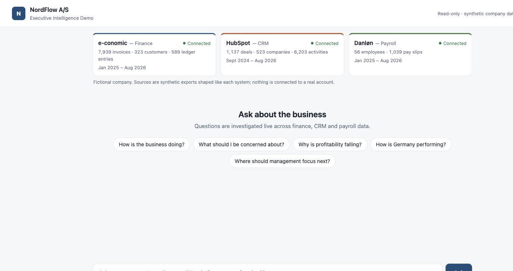
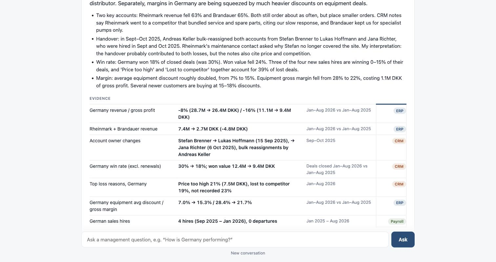

# NordFlow Phase 3 — Interactive Executive Demo

A small browser demo. A manager asks questions in plain language, and an LLM
investigates the fictional company NordFlow A/S live through the read-only
Phase 2 MCP tools. It replies with a short executive answer, the supporting
evidence and the sources used. Follow-up questions keep the conversation's
context.

This is a demo, not a product. The company, its data and the "connected"
systems are synthetic.



## Run it

```bash
python3 -m venv phase2/.venv && phase2/.venv/bin/pip install -r phase3/requirements.txt   # once
make demo                        # -> http://127.0.0.1:8765
make demo-check                  # validate configuration + data, then exit (no port, no model call)
```

| Variable | Default | Meaning |
|---|---|---|
| `NORDFLOW_MODE` | `local` | `deploy` turns on the remote-deployment rules: API agent, API key and Basic auth all required. See [DEPLOY.md](DEPLOY.md). |
| `NORDFLOW_AGENT` | `auto` | `api`: Anthropic API. `cli`: Claude Code headless. `auto`: `api` if an API key is set, otherwise `cli` if `claude` is installed. |
| `ANTHROPIC_API_KEY` | – | Required for `api` mode. Server-side only; never hardcoded, never sent to the browser, never logged. |
| `NORDFLOW_AUTH_USER` / `NORDFLOW_AUTH_PASSWORD` | – | Shared HTTP Basic credentials. Optional locally (setting either one turns auth on), required in `deploy` mode. |
| `NORDFLOW_MODEL` | `claude-opus-5` | Model for either mode |
| `NORDFLOW_EFFORT` | `medium` | Thinking effort: `low` / `medium` / `high` / `xhigh` / `max`. Medium keeps answers at about 30–50 s. |
| `NORDFLOW_HOST` / `NORDFLOW_PORT` | `127.0.0.1` / `8765` | Bind address. In `deploy` mode a non-loopback bind is refused unless TLS is terminated in front (`NORDFLOW_ALLOW_PUBLIC_BIND=1`). |
| `NORDFLOW_MAX_CONVERSATIONS` / `NORDFLOW_MAX_QUESTION_CHARS` | `50` / `2000` | Memory and request-size limits |

Configuration is environment-only and is validated before the server starts:
missing secrets, a bad effort value or a CLI agent in deploy mode are reported
together with exit code 2, and `--check` also starts the MCP server and reads the
dataset. `phase3/config.py` holds the rules, `phase3/auth.py` the Basic auth
middleware.

**CLI mode** uses a logged-in `claude` CLI instead of an API key. It runs with
the same isolation as the Phase 2B runs: no built-in tools, only the NordFlow
MCP server, and no user or project settings. Its sessions are stored by Claude
Code under `~/.claude/projects/` (one per demo conversation, in a temporary
working directory).

Tests: `make demo-test` runs the Phase 2 and Phase 3 tests (114). They make no LLM calls.

**Deployment.** [DEPLOY.md](DEPLOY.md) is a step-by-step guide for a private
1 vCPU / 2 GB Linux VM: systemd unit, Caddy for TLS, an environment file for the
secrets, and what the hardening does and does not cover. Nothing is deployed yet.

## Architecture

```
Browser (web/index.html, app.js, style.css — static, no build step)
   │  POST /api/conversations/{id}/ask  → server-sent events: tool_call, tool_result, answer
   ▼
Shared HTTP Basic auth (auth.py) on every route except /healthz · config + secrets (config.py)
   │
   ▼
Demo backend (server.py — Starlette/uvicorn, in-memory conversations, JSONL logs)
   │
   ▼
Agent (agent/api_agent.py — Anthropic SDK tool loop   |   agent/cli_agent.py — Claude Code headless, resumed session)
   │  MCP over stdio
   ▼
Demo MCP server (mcp_server.py) = Phase 2A tools, unchanged (33) + present_answer
   │
   ▼
Phase 2A runtime: ERP · CRM · Payroll · Mappings adapters → data/ (Phase 1 v1.1)
```

**No analysis in the backend.** Every figure comes from the agent's MCP calls.
The backend makes one MCP call of its own, `meta_describe_sources`, to show
record counts on the source cards.

**Answer shape.** The agent finishes by calling `present_answer` with a
headline, up to 4 key points, evidence (metric, value, period, source system)
and up to 3 follow-up questions. The tool only echoes its input. The UI renders
these fields separately, so the conclusion is visually distinct from the
evidence.

**Traceability.** The backend records every MCP call per turn: tool, arguments,
system, ok/error, duration and result size. Each evidence row is checked
against the systems actually queried in the conversation; an unconfirmed row
shows its source chip with a "?". The trace is available under **How this was
investigated** in each answer.

**Context.**
- API mode keeps the full message history per conversation, with prompt caching.
- CLI mode resumes the same Claude Code session.
- Conversations live in server memory. `?c=<id>` or a page reload re-renders one; a server restart loses them.

**Agent instruction** (`agent/prompt.py`). It is the neutral Phase 2B
instruction plus presentation rules: be concise, prioritise, give evidence
from tool results, offer follow-ups. It contains no scenario hints.
`tests/test_demo.py` fails if demo code imports Phase 1 or evaluation code, or
mentions the answer key or scenario entities.

**Logs.** Each turn appends one line to `logs/<conversation>.jsonl` (git-ignored). A line holds:
- the question and final structured answer
- the tool calls, including MCP errors
- elapsed time and token usage

No model reasoning is stored. A real three-turn conversation is kept in `docs/example-conversation.jsonl`.

**API mode details.**
- Manual tool loop on `client.beta.messages.create` with adaptive thinking, `output_config.effort` and top-level prompt caching.
- Server-side refusal fallback: `server-side-fallback-2026-07-01`, `fallbacks: "default"`.
- Parallel tool calls run concurrently over one persistent MCP connection.
- Tool results are capped at 60k characters.

## Example conversation (real run, CLI mode, claude-opus-5, effort medium)

**1. "How is the business doing?"** — 28 s · 5 queries (ERP, CRM, Payroll)
> Sales are growing slightly, but profit is falling. In Jan–Aug 2026, revenue was up 2% on the same months of 2025. Over the same period, operating profit fell 34% (16.0M → 10.6M DKK) and operating margin dropped from 14.2% to 9.2%. Two things are driving this: gross margin fell 3 points and personnel costs rose 12%. Denmark and Germany are the weak spots; Sweden is holding up.

Evidence: revenue +2% · gross margin 40.0% → 37.1% · operating profit −34% · personnel +12% · Germany revenue −8%, discount 5.2% → 9.7% · win rate 31% → 27%

**2. "Why is Germany performing badly?"** — 47 s · 12 queries (ERP, CRM, Payroll, Mappings)
> Most of Germany's decline comes from two long-standing customers, not from the market as a whole. Rheinmark Chemie and Brandauer Papierwerke bought 4.8M DKK less in Jan–Aug 2026 than a year earlier, which is more than Germany's total revenue drop of 2.3M DKK. Both accounts were moved from Stefan Brenner to newly hired sales reps in a territory reorganisation in autumn 2025. Shortly after, Rheinmark cancelled its service contract and Brandauer moved its spare-parts business to a local distributor. Separately, margins in Germany are being squeezed by much heavier discounts on equipment deals.

Evidence: Germany revenue −8%, gross profit −16% · two accounts 7.4M → 2.7M DKK · owner changes 15 Sep / 6 Oct 2025 · win rate 30% → 18% · equipment discount 7.0% → 15.3% · 4 German sales hires

**3. "Did hiring more salespeople there pay off?"** — 37 s · 4 queries (Payroll, CRM). Context resolved "there" to Germany.
> Not yet. The four salespeople hired in Germany between Sept 2025 and Jan 2026 have cost about 2.2M DKK in employer costs so far. In that time they have won deals worth 3.0M DKK, which is roughly 1M DKK of gross profit at Germany's margin. Across the whole German team, many more deals were closed but total won value barely moved. So the extra effort has not produced extra sales. The hires are still new, though, and ramp-up time and deals still open could change this.



## Limitations

- **Latency.** Answers take roughly 30–50 s at medium effort, and deep questions can take longer. Progress streams live, but it is not instant.
- **Nondeterminism.** Answers and depth vary between runs (see the Phase 2B baseline). The agent can still stop early or pick a different comparison window.
- **Evidence check.** The check is coarse: it confirms the stated source system was queried, not that each number matches a tool result. Figures in the example were spot-checked, not automatically verified.
- **API mode not run live here.** It is covered by tests with a scripted model and the real MCP server. The live runs above used CLI mode, because this machine has no API key.
- **Small and shared.** One shared Basic-auth credential for everyone, no accounts, no rate limiting, no audit trail; conversations live in memory and are lost on restart. Enough for a private demo, not for anything else. CLI mode depends on a local Claude Code login and is not usable for a deployment.
- **Data.** Synthetic data ends on 31 Aug 2026. No external data, no real integrations.
